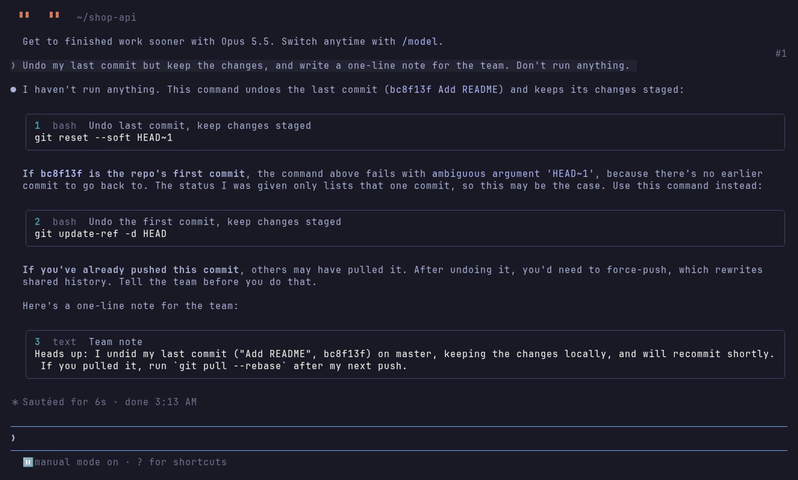
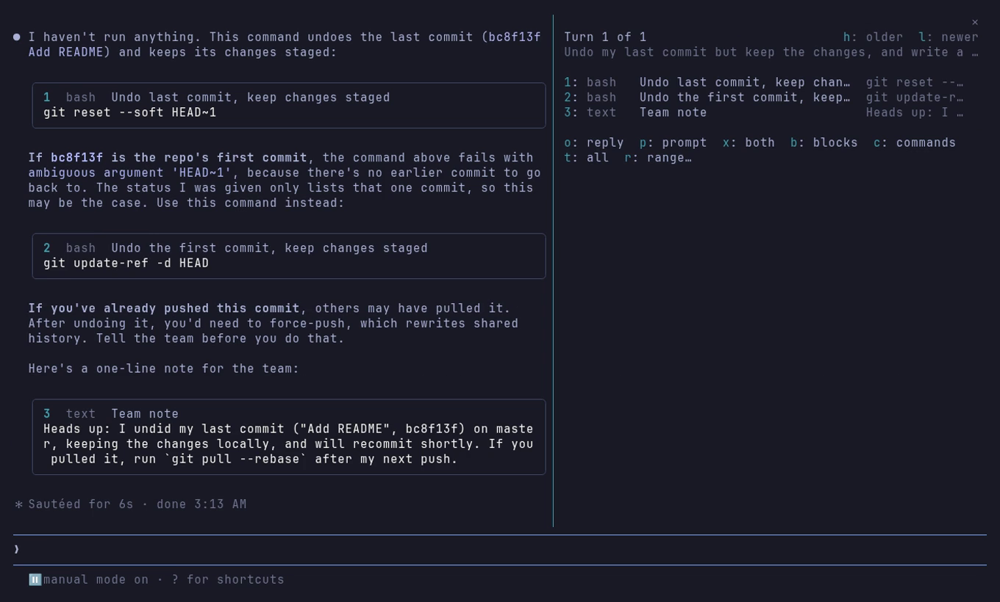
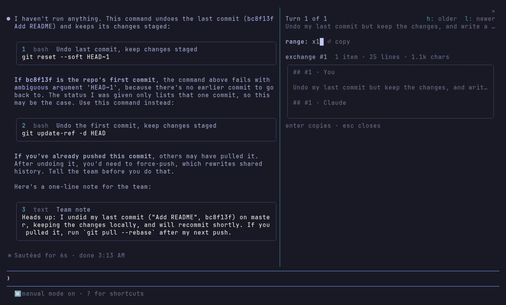

<p align="center">
  
</p>

<h1 align="center">yank</h1>

<p align="center">
  <b>Copy anything from a Claude Code conversation in two keys.</b><br>
  A block, a reply, a prompt, a range of turns, the commands Claude ran, or the whole transcript.
</p>

<p align="center">
  <a href="LICENSE"></a>
  
  
</p>

<p align="center">
  
</p>

Claude writes a lot of things meant to be pasted somewhere else: a command to run, a snippet, a message for your team. In a terminal, getting them out means a mouse drag that picks up line wraps, indentation and the edges of the box. yank turns every one of them into something you copy with a key.

## What it does

- **Claude marks what is meant to be copied.** A short note in Claude's system prompt asks it to put every command, snippet or message for you in its own fenced block, titled on its fence line.
- **Each such block becomes a card** captioned with its key, language and title: `1  bash  Undo last commit, keep changes staged`.
- **`ctrl+x y` opens the palette.** One key copies: `1`-`9` a block, `o` the reply, `p` the prompt, `x` both, `b` every block, `c` the commands Claude ran, `t` the whole conversation. `h`/`l` step through older turns.
- **Ranges, with a preview.** Press `r` and type `o2-5` (replies 2 to 5) or `x1-3` (exchanges 1 to 3, with prompts): the palette shows what it will copy, its size and its first lines before you press Enter.
- **Exact text.** Copies come from the stored conversation, never the screen: no wrapped lines, no box edges, no lost indentation.
- **Clipboard-history aware.** Several items (`b`, `1-3`) are copied last-first with a short gap, so a clipboard manager keeps each as its own entry and the first one is what you paste.
- **Quiet by default.** Nothing sits above your prompt. Prompts get a faint `#n` at their right edge so ranges have something to point at. Auto-copy and an always-on band are there when you want them.

<table>
  <tr>
    <td></td>
    <td></td>
    <td></td>
  </tr>
  <tr>
    <td align="center">Claude's blocks, keyed</td>
    <td align="center">The palette</td>
    <td align="center">A range, previewed</td>
  </tr>
</table>

## Install

At a Claude Code prompt:

```text
/plugin install yank --marketplace AryanHamedani/claude-yank
```

Answer `y` to add the marketplace, then pick a scope. From a shell:

```bash
claude plugin install yank --marketplace AryanHamedani/claude-yank
```

Then bind the palette to `ctrl+x y` (this edits `keybindings.json` in your Claude Code config folder and keeps a `.bak-yank` copy first):

```text
/yank keys
```

yank is a Claude Code *mod*, a plugin of function hooks. It needs a Claude Code build with mods (developed and tested on 2.1.312), and draws in the terminal and the desktop app.

## The yank grammar

The same words work in the palette's range field and as `/yank <word>`, which copies without opening anything.

| Word | Copies |
|---|---|
| `2` | block 2 of the latest reply |
| `1-3` | blocks 1 to 3, one clipboard item each |
| `4.2` | block 2 of turn 4 |
| `o` · `o3` · `o2-5` | the latest reply · reply 3 · replies 2 to 5 |
| `p` · `p3` · `p1,4` | the latest prompt · prompt 3 · prompts 1 and 4 |
| `x` · `x2-` | prompt and reply together · exchange 2 to the latest |
| `b` · `b*` | every block of the reply · every block in the conversation |
| `c` · `c3` | the shell commands Claude ran, as one script |
| `t` | the whole conversation, as Markdown |

A range is `n`, `a-b`, `a-` (to the latest), `*` (all), or a list of them: `1,3,5-`.

## Settings

Every setting is a row in `/config`. You can also just ask Claude: the bundled `customize-yank` skill knows them all, including how to make yank match your terminal's theme.

| Setting | Default | |
|---|---|---|
| `look` | `card` | `card`, `quiet` (caption only) or `off` (Claude Code's own drawing) |
| `border` | `round` | the card's line: `round`, `single`, `double`, `bold`, `dashed`, `classic` |
| `frameColor` | `subtle` | a Claude Code theme key, or `#rrggbb` |
| `accentColor` | `suggestion` | keys and range words; a theme key or `#rrggbb` |
| `paneBackground` | `transparent` | the palette shows your terminal's own background |
| `ids` | `true` | the faint `#n` beside prompts |
| `autoCopy` | `off` | `single`: a reply's only block is on your clipboard when Claude finishes; `all`: every block |
| `band` | `false` | the latest blocks above the prompt; a bare digit in an empty prompt copies one |
| `confirm` | `true` | a toast after each copy |
| `guide` | `true` | the system-prompt note that makes Claude fence and title what you will paste |
| `keys` | `reply=o prompt=p …` | remap palette keys, e.g. `prev=k next=j` |
| `speakers` | `You\|Claude` | names in a copied exchange |
| `stackGapMs` | `350` | the gap between stacked copies, for clipboard managers |

yank's colors default to your Claude Code theme's own keys, the same ones Claude Code draws the palette's frame with, so it matches whatever theme you use.

## How it compares

Claude Code's built-in `/copy` copies the last reply, with a picker for its code blocks, and can be bound to a key with `command:copy`. Reach for it when that is all you need. yank adds what it does not do: Claude choosing and titling what is copyable, keys that are visible on the cards, any turn rather than the last, ranges of prompts and replies, the commands Claude ran, and clipboard-history stacking.

## Privacy

- With `guide` on (the default), yank adds a short note about fencing to Claude's system prompt. Turn it off to keep the prompt untouched.
- yank writes to your clipboard only when you ask, unless you turn `autoCopy` on.
- `/yank keys` is the one command that writes a file: your `keybindings.json`, backed up first.
- Nothing leaves your machine.

## Development

```text
hooks/register.tsx   wiring: engine events to views and actions
hooks/spec.ts        the yank grammar, a pure function
hooks/transcript.ts  turns, prompts, replies and commands from the session
hooks/blocks.ts      the fence parser
hooks/views.tsx      cards, palette, prompt numbers, band
hooks/clipboard.ts   single and stacked copies
hooks/settings.ts    every setting, with safe defaults
skills/customize-yank/SKILL.md   lets an agent change the settings
```

Run it from a checkout with `claude --plugin-dir .`, and check it with:

```bash
claude plugin validate . && claude plugin test .
```

`tsc -p .` type-checks once Claude Code has loaded the mod and written its types to `.claude-plugin/types/`.

## License

[MIT](LICENSE) © Aryan Hamedani
